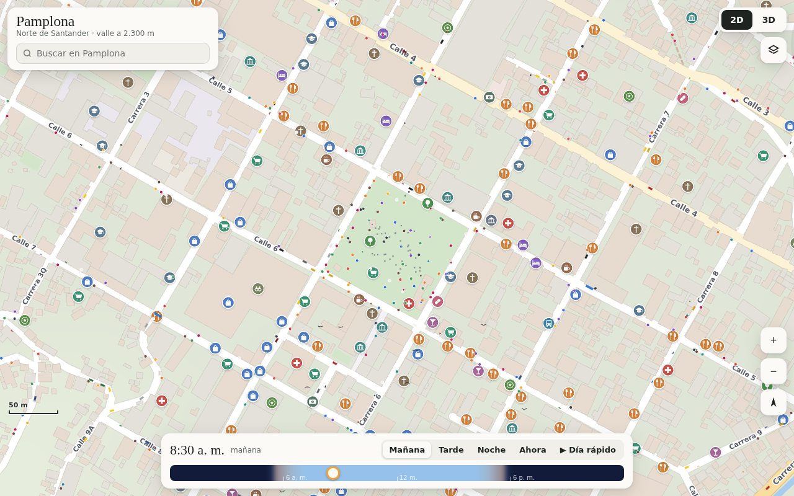

# Mapa vivo de Pamplona

Mapa interactivo de Pamplona (Norte de Santander, Colombia) en 2D y 3D. La luz cambia según la hora real del día y la posición del sol, muestra los lugares de la ciudad y tiene vida simulada: personas, carros, motos, bicis, animales, nubes y lluvia.

- **Abrir el mapa:** descarga `pamplona-map.html` y ábrelo con Chrome, Edge o Firefox. Es un solo archivo; solo necesita internet para cargar three.js la primera vez.
- **Versión publicada (privada):** https://claude.ai/artifact/2hBMEyBgPrGjVWbwbPzEaj



## Contenido de esta carpeta

| Ruta | Qué es |
|---|---|
| `pamplona-map.html` | El mapa terminado (1,4 MB). Es lo único que necesitas para usarlo. |
| `fuente/page.html` | El código del mapa (HTML, CSS y JavaScript) con la marca `/*DATA*/` donde van los datos. |
| `fuente/data.json` | Los datos de Pamplona ya procesados: calles, edificios, lugares, barrios y relieve. |
| `fuente/fetch.py` | Descarga los datos de Overture Maps para el área de Pamplona. |
| `fuente/prep.py` | Convierte esos datos en `data.json`. |
| `fuente/build.py` | Une `page.html` y `data.json` en `pamplona-map.html`. |
| `fuente/shot.cjs` | Script de pruebas que toma capturas con Playwright. |
| `fuente/tiles/` | Las 20 imágenes de relieve (AWS Terrain Tiles, zoom 13) que usa `prep.py`. |
| `capturas/` | Capturas del mapa en 2D, 3D, de día, de noche y en celular. |

## Manual de uso

### Botones y controles

| Control | Qué hace |
|---|---|
| **Buscador** (arriba a la izquierda) | Busca calles, barrios y lugares. Enter va al primer resultado; Esc cierra la lista. |
| **2D / 3D** (arriba a la derecha) | Cambia entre el mapa plano y la vista en 3D. |
| **Capas** (botón debajo de 2D/3D) | Abre el panel para mostrar u ocultar cada tipo de lugar y cada tipo de vida. |
| **+ / −** | Acerca o aleja. |
| **Flecha** | Vuelve al centro (Parque Águeda Gallardo) y orienta el mapa al norte. |
| **Mañana / Tarde / Noche** | Pone la hora en 8:30 a. m., 4:20 p. m. o 9:15 p. m. |
| **Ahora** | Usa la hora real de Colombia (UTC−5). El mapa arranca así. |
| **▶ Día rápido** | Pasa el día a 15 minutos por segundo. |
| **Barra del sol** | Arrástrala para elegir cualquier hora. |
| **Clic en un lugar** | Abre su ficha con categoría y, si los hay, dirección, teléfono y sitio web. "Acercar" lleva el mapa a ese lugar. |

### Moverse por el mapa

- **2D:** arrastra para moverte; rueda del mouse o pellizco para hacer zoom.
- **3D:** arrastra para moverte, clic derecho o Shift + arrastrar para girar e inclinar la cámara (en celular, dos dedos), rueda o pellizco para acercar.

### Qué muestra

- **En 2D:** calles con su nombre, nombres de los barrios, edificios con sombra, parques, canchas, el río y el relieve sombreado. Los íconos de lugares aparecen a medida que haces zoom.
- **En 3D:** el terreno real del valle (unos 2.300 m de altura) y más de 11.000 edificios. El centro tiene casas coloniales: paredes blancas con zócalo de color, techos de teja a dos aguas, puertas de madera, rejas y balcones. Afuera hay edificios modernos con ventanas, locales y tanques de agua. La catedral tiene torre y campanario, y en el parque hay un monumento. Hay sombras según la dirección del sol y, de noche, las ventanas y los postes se encienden.
- **Hora del día:** el color del cielo, la luz y las sombras se calculan con la posición real del sol en Pamplona.
- **Lugares (21 categorías):** policía y bomberos, salud, farmacias, restaurantes, cafés, bares, tiendas, mercados, hoteles, educación, iglesias, cultura, bancos, parques, deporte, transporte, talleres, mascotas, gobierno, cerros y servicios.
- **Vida simulada:** unas 950 personas, 170 carros, 55 taxis, 14 busetas, 140 motos, bicis, patinetas, perros, gatos en los techos, vacas y caballos en las afueras, palomas en el parque, pájaros, nubes, puestos de comida y lluvia. Hay más gente de día que de noche, y se concentra cerca del centro. En celular hay menos para que no se ponga lento.

## Tecnologías usadas

| Parte | Tecnología |
|---|---|
| Página | Un solo archivo HTML con CSS y JavaScript sin frameworks. |
| Mapa 2D | Canvas 2D: la capa fija (calles, edificios, relieve) se dibuja una vez y se reutiliza al moverse; encima van la vida y las etiquetas. |
| Vista 3D | [three.js r128](https://threejs.org/) desde cdnjs. Los edificios se unen en una sola geometría y un shader propio les dibuja ventanas, puertas y balcones. Los árboles y la vida usan `InstancedMesh` para que sea rápido. |
| Íconos | Dibujados a mano con Canvas, sin imágenes ni emojis. |
| Sol | Fórmula astronómica de la NOAA para la altura y dirección del sol según la fecha y la hora en Pamplona. |
| Vida | Un grafo con las calles reales: los carros van por las vías y las personas por los andenes y senderos. |
| Datos | Python con `pyarrow`, `fsspec`, `shapely`, `numpy` y `Pillow`. |
| Pruebas | Playwright con Chromium para tomar capturas. |

### Fuentes de datos

- **[Overture Maps](https://overturemaps.org/)** (versión 2026-09-23.1), que incluye datos de **OpenStreetMap** (licencia ODbL): calles, edificios, lugares, uso del suelo y agua.
- **[AWS Terrain Tiles](https://registry.opendata.aws/terrain-tiles/)**: el relieve del terreno.
- Los barrios salen de las direcciones de los lugares ("barrio El Carmen", etc.).
- Las alturas de los edificios son aproximadas y la vida es simulada; no son datos en tiempo real.
- No se usó Google Maps porque su licencia no permite copiar sus datos.

## Cómo modificarlo

Para cambios en el diseño, los colores o el comportamiento solo hace falta editar `fuente/page.html` y volver a armar el archivo:

```bash
cd fuente
python3 build.py        # crea pamplona-map.html y test.html
cp pamplona-map.html ..
```

Para actualizar los datos de la ciudad (calles, edificios o lugares nuevos):

```bash
cd fuente
pip install pyarrow fsspec requests shapely numpy pillow
python3 fetch.py        # descarga Overture a fuente/data/ (unos 7 MB, no se guarda en el repo)
python3 prep.py         # crea data.json
python3 build.py
```

En `fetch.py`, `X0, X1, Y0, Y1` definen el área (longitud y latitud).

### Partes principales de `page.html`

| Función o constante | Qué hace |
|---|---|
| `drawGlyph`, `badge`, `iconURL` | Dibujan los íconos de los lugares. |
| `elevAt` | Da la altura del terreno en cualquier punto. |
| `ROAD_STYLE`, `LU_FILL` | Colores y grosor de calles y zonas en 2D. |
| `GROUPS` | Las categorías de lugares: nombre, ícono y color. |
| `sunPos`, `lightAt` | Posición del sol y colores de luz según la hora. |
| `buildGraph`, `spawnOnGraph`, `stepAgents` | Crean y mueven la vida simulada. |
| `paintWorld`, `paintLabels`, `render2d` | Dibujan el mapa 2D. |
| `init3d`, `update3d` | Arman y actualizan la escena 3D. |
| `flyTo`, `setView`, `showCard` | Moverse a un punto, cambiar 2D/3D y abrir la ficha de un lugar. |

Las coordenadas internas están en metros, con el origen en longitud −72.6465, latitud 7.3770. El centro del parque queda más o menos en (−190, −65).

## Limitaciones

- Los edificios no son copias exactas de los reales: la forma y la ubicación vienen de los datos, pero las fachadas y alturas son aproximadas.
- Algunos lugares pueden estar desactualizados o tener la categoría equivocada, porque vienen de fuentes abiertas.
- La vista 3D necesita WebGL. En celulares viejos puede ir lenta.
